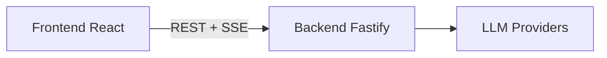

# SubTranslate AI — Maintenance context for agents

This document guides agents and developers maintaining **SubTranslate AI** (npm name: `subtranslate-ai`).

## What this project is

A full-stack web app for translating `.srt` subtitles **cue by cue** (block by block) using LLMs. It never translates the entire file in a single LLM call.

**Stack:**
- npm workspaces monorepo: `shared`, `backend`, `frontend`
- **Backend:** Fastify + TypeScript (port 3001)
- **Frontend:** React 18 + Vite + TypeScript (port 5173, proxies `/api` → backend)
- **Shared:** shared TypeScript types (`@subtranslate-ai/shared`)

**Commands:**
```bash
npm install
npm run dev      # kills process on 3001, starts backend + frontend
npm run build
npm test         # backend tests (vitest)
```

## High-level architecture

```
Upload .srt → parse (backend) → LLM config + languages (frontend)
     → POST /api/jobs → translateSrtDocument (async)
     → SSE /api/jobs/:id/events → UI updates progress
     → GET /api/jobs/:id/download → translated .srt
```



## Folder structure

```
subtranslate-ai/
├── shared/src/types.ts       # Shared types (Cue, Settings, Job, etc.)
├── backend/src/
│   ├── server.ts             # Fastify entry point
│   ├── routes/index.ts       # All REST + SSE routes
│   ├── jobs/jobStore.ts      # In-memory jobs (1h TTL); API key stored separately
│   ├── srtParser.ts          # parseSrt / serializeSrt
│   ├── llmProviders/         # LLM abstraction and implementations
│   └── translation/          # Translation engine (critical logic)
├── frontend/src/
│   ├── App.tsx               # Global UI state
│   ├── api/client.ts         # HTTP client + EventSource
│   ├── components/           # Modular UI
│   └── lib/                  # Cookies, languages, detection, formatting
├── README.md                 # User documentation
└── AGENTS.md                 # This file
```

## Critical modules (do not break without understanding)

### 1. SRT parser — `backend/src/srtParser.ts`

- `parseSrt(content)` → `SubtitleCue[]` with 0-based `id`, `status: "pending"`
- `serializeSrt(cues)` → preserves index and timestamps; only replaces text
- Strict format validation; errors via `SrtParseError`

### 2. Translation engine — `backend/src/translation/`

| File | Responsibility |
|------|----------------|
| `buildContextWindow.ts` | Sliding window: N cues before/after the current one |
| `buildTranslationPrompt.ts` | System/user JSON prompt; natural-language instructions |
| `validateTranslation.ts` | Context-leakage checks + `parseTranslationResponse` |
| `translateCue.ts` | Single cue: LLM → parse JSON → validate → retries |
| `translateSrtDocument.ts` | Orchestrates all cues in **parallel batches** (`parallelism`) |

**Important business rules:**
- One LLM call per cue (never the whole file)
- Previous cues in context include `translatedText` when already translated
- Next cues only include original text
- Retry with a stricter prompt if `validateTranslation` fails
- After retries are exhausted → `needs_review` status, job continues
- In-memory cache by hash (text + settings) within the same job
- `parallelism`: processes in batches; each batch waits for the previous one for consistent context

### 3. LLM providers — `backend/src/llmProviders/`

Interface in `base.ts`:
```typescript
interface LlmProvider {
  chatCompletion(params): Promise<{ content, usage? }>;
}
```

- `createProvider(providerId, apiKey, customBaseUrl?)` — factory
- `withRetry` — exponential backoff for 429/5xx
- `listModels.ts` — lists models via each provider's API
- OpenAI-compatible: OpenAI, DeepSeek, OpenRouter, Custom
- Native: Anthropic, Gemini
- **Never log API keys** — use `redactSecrets()`

### 4. Job store — `backend/src/jobs/jobStore.ts`

- In-memory state (does not survive restarts)
- API key in a separate `Map`, deleted when the job ends
- SSE via subscribers per jobId
- Pause/resume/cancel via flags + promises

## REST API

| Method | Route | Description |
|--------|-------|-------------|
| POST | `/api/parse` | Multipart `.srt` upload |
| POST | `/api/models` | List models (requires apiKey in body) |
| POST | `/api/jobs` | Start async translation |
| GET | `/api/jobs/:id` | Job state (no apiKey) |
| GET | `/api/jobs/:id/events` | SSE events |
| POST | `/api/jobs/:id/cancel` | Cancel |
| POST | `/api/jobs/:id/pause` | Pause after current cue |
| POST | `/api/jobs/:id/resume` | Resume |
| GET | `/api/jobs/:id/download` | Translated `.srt` file |
| GET | `/api/jobs/:id/report` | JSON of failed/needs_review cues |

## Frontend — main components

| Component | Purpose |
|-----------|---------|
| `SrtUpload` | Upload; shows filename and cue count |
| `LanguageDirectionPanel` | Source/target + swap + auto-detect |
| `LanguageSearchSelect` | Searchable combobox (180+ languages) |
| `LlmConfigForm` | Provider, API key, model, parameters |
| `TranslationControls` | Translate / Pause / Resume / Cancel |
| `ProgressBar` | Progress bar + total time on completion |
| `TranslationDashboard` | Recharts graphs + ETA estimate |
| `CuePreview` | Side-by-side original vs translated table |
| `DownloadBar` | Download + completion banner with elapsed time |

### Frontend libs (`frontend/src/lib/`)

| File | Purpose |
|------|---------|
| `llmConfigCookies.ts` | Persists config + API key in cookie (1 year); migrates legacy names |
| `languages.ts` | List via `iso-639-1` + regional variants |
| `detectLanguage.ts` | Auto-detect with `franc-min` + `langs` |
| `formatDuration.ts` | Formats seconds → `Xm Ys` |

### State in `App.tsx`

- `settings` + `apiKey` auto-saved to cookie (400ms debounce)
- `progressHistory` for charts and ETA
- `elapsedSeconds` captured on terminal status (completed/cancelled/failed)
- Source language auto-detect on SRT upload

## Security

- API key sent once in `POST /api/jobs`; kept in backend memory only
- Never return apiKey in SSE, GET job, or logs
- Frontend cookie contains apiKey — document risk for production
- CORS limited to `localhost:5173` in dev

## Tests

Backend uses **Vitest** (`backend/src/__tests__/`):
- `srtParser.test.ts`
- `buildContextWindow.test.ts`
- `validateTranslation.test.ts`
- `listModels.test.ts` (skipped without `DEEPSEEK_API_KEY`)

Run from root: `npm test`.

## Code conventions

- TypeScript strict in all packages
- ESM imports with `.js` suffix in backend
- Shared types always in `shared/` — do not duplicate
- UI in **English**; critical backend comments in English
- Minimal, focused changes; do not refactor unnecessarily
- Do not mock LLM in the main flow — use real provider abstractions

## Common extension points

### New LLM provider
1. Create `backend/src/llmProviders/newprovider.ts` implementing `LlmProvider`
2. Register in `llmProviders/index.ts` (`createProvider`)
3. Add to `LLM_PROVIDERS` in `shared/src/types.ts`
4. If OpenAI-compatible, reuse `createOpenAiProvider` with a baseURL
5. Add listing in `listModels.ts` if applicable

### New TranslationSettings field
1. `shared/src/types.ts` + default in `DEFAULT_TRANSLATION_SETTINGS`
2. `LlmConfigForm.tsx` (UI)
3. `buildTranslationPrompt.ts` if it affects the prompt
4. Cookie already serializes the full object — works automatically

### New cue status
1. `CueStatus` in `shared/src/types.ts`
2. `translateCue.ts` / `translateSrtDocument.ts`
3. `jobStore.ts` (emit events)
4. `CuePreview.tsx` + CSS badges
5. `TranslationDashboard.tsx` (counts)

## Known pitfalls

1. **Port 3001 in use:** `npm run dev` kills the old process; running an outdated backend manually causes 404s (e.g. `/api/models`).

2. **SSE:** connection stays open; `routes/index.ts` resolves the promise on client `close`.

3. **Cookies ~4KB:** long glossaries are truncated in `llmConfigCookies.ts`.

4. **Parallelism vs context:** cues in the same batch do not see each other's translations; sequential batches do.

5. **franc-min:** needs minimum text (~20 chars); returns `und` when uncertain.

6. **Workspace folder:** path may be `srt-forge` but packages are `@subtranslate-ai/*`.

## Pre-PR checklist

- [ ] `npm run build` passes (shared → backend → frontend)
- [ ] `npm test` passes
- [ ] API key never appears in logs or public responses
- [ ] SRT timestamps/indices preserved after parser/serializer changes
- [ ] Translation remains cue-by-cue (not whole-file batch)

## Quick reference: cue statuses

| Status | Meaning |
|--------|---------|
| `pending` | Waiting |
| `translating` | LLM call in progress |
| `translated` | Success |
| `retrying` | Retry after validation or network failure |
| `failed` | Definitive error |
| `needs_review` | Suspicious translation; job continues |

---

Last updated: reflects SubTranslate AI with parallelism, auto-detect, cookies, dashboard, and dynamic model listing.
