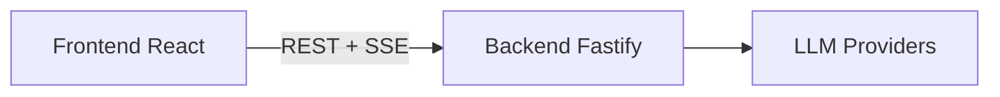

# SubTranslate AI — Contexto para agentes de manutenção

Este documento orienta agentes e desenvolvedores que vão dar manutenção no projeto **SubTranslate AI** (nome npm: `subtranslate-ai`). O diretório no disco pode ainda se chamar `srt-forge`; isso é legado do rename.

## O que é o projeto

Aplicação web full-stack para traduzir legendas `.srt` **cue por cue** (bloco por bloco) usando LLMs. Nunca traduz o arquivo inteiro em uma única chamada.

**Stack:**
- Monorepo npm workspaces: `shared`, `backend`, `frontend`
- **Backend:** Fastify + TypeScript (porta 3001)
- **Frontend:** React 18 + Vite + TypeScript (porta 5173, proxy `/api` → backend)
- **Shared:** tipos TypeScript compartilhados (`@subtranslate-ai/shared`)

**Comandos:**
```bash
npm install
npm run dev      # mata processo na 3001 e sobe backend + frontend
npm run build
npm test         # testes do backend (vitest)
```

## Arquitetura em alto nível

```
Upload .srt → parse (backend) → config LLM + idiomas (frontend)
     → POST /api/jobs → translateSrtDocument (async)
     → SSE /api/jobs/:id/events → UI atualiza progresso
     → GET /api/jobs/:id/download → .srt traduzido
```



## Estrutura de pastas

```
subtranslate-ai/
├── shared/src/types.ts       # Tipos compartilhados (Cue, Settings, Job, etc.)
├── backend/src/
│   ├── server.ts             # Entry point Fastify
│   ├── routes/index.ts       # Todas as rotas REST + SSE
│   ├── jobs/jobStore.ts      # Jobs em memória (TTL 1h); API key separada
│   ├── srtParser.ts          # parseSrt / serializeSrt
│   ├── llmProviders/         # Abstração e implementações de LLM
│   └── translation/          # Motor de tradução (lógica crítica)
├── frontend/src/
│   ├── App.tsx               # Estado global da UI
│   ├── api/client.ts         # Cliente HTTP + EventSource
│   ├── components/           # UI modular
│   └── lib/                  # Cookies, idiomas, detecção, formatação
├── README.md                 # Documentação do usuário
└── AGENTS.md                 # Este arquivo
```

## Módulos críticos (não quebrar sem entender)

### 1. Parser SRT — `backend/src/srtParser.ts`

- `parseSrt(content)` → `SubtitleCue[]` com `id` 0-based, `status: "pending"`
- `serializeSrt(cues)` → preserva índice e timestamps; só substitui texto
- Validação estrita de formato; erros via `SrtParseError`

### 2. Motor de tradução — `backend/src/translation/`

| Arquivo | Responsabilidade |
|---------|------------------|
| `buildContextWindow.ts` | Janela deslizante: N cues antes/depois do atual |
| `buildTranslationPrompt.ts` | System/user prompt JSON; instruções de naturalidade |
| `validateTranslation.ts` | Anti-vazamento de contexto + `parseTranslationResponse` |
| `translateCue.ts` | Uma cue: LLM → parse JSON → validar → retries |
| `translateSrtDocument.ts` | Orquestra todas as cues em **lotes paralelos** (`parallelism`) |

**Regras de negócio importantes:**
- Uma chamada LLM por cue (nunca o arquivo inteiro)
- Cues anteriores no contexto incluem `translatedText` quando já traduzidas
- Cues posteriores só têm texto original
- Retry com prompt mais restritivo se `validateTranslation` falhar
- Após esgotar retries → status `needs_review`, continua o job
- Cache em memória por hash (texto + settings) dentro do mesmo job
- `parallelism`: processa em lotes; cada lote espera o anterior para contexto consistente

### 3. LLM Providers — `backend/src/llmProviders/`

Interface em `base.ts`:
```typescript
interface LlmProvider {
  chatCompletion(params): Promise<{ content, usage? }>;
}
```

- `createProvider(providerId, apiKey, customBaseUrl?)` — factory
- `withRetry` — backoff exponencial para 429/5xx
- `listModels.ts` — lista modelos via API de cada provedor
- OpenAI-compatible: OpenAI, DeepSeek, OpenRouter, Custom
- Nativos: Anthropic, Gemini
- **Nunca logar API key** — usar `redactSecrets()`

### 4. Job store — `backend/src/jobs/jobStore.ts`

- Estado em memória (não persiste entre restarts)
- API key em `Map` separado, apagada ao fim do job
- SSE via subscribers por jobId
- Pause/resume/cancel via flags + promises

## API REST

| Método | Rota | Descrição |
|--------|------|-----------|
| POST | `/api/parse` | Upload multipart `.srt` |
| POST | `/api/models` | Lista modelos (requer apiKey no body) |
| POST | `/api/jobs` | Inicia tradução async |
| GET | `/api/jobs/:id` | Estado do job (sem apiKey) |
| GET | `/api/jobs/:id/events` | SSE de eventos |
| POST | `/api/jobs/:id/cancel` | Cancela |
| POST | `/api/jobs/:id/pause` | Pausa após cue atual |
| POST | `/api/jobs/:id/resume` | Retoma |
| GET | `/api/jobs/:id/download` | Arquivo `.srt` traduzido |
| GET | `/api/jobs/:id/report` | JSON de cues failed/needs_review |

## Frontend — componentes principais

| Componente | Função |
|------------|--------|
| `SrtUpload` | Upload; exibe nome do arquivo e contagem de cues |
| `LanguageDirectionPanel` | Source/target + swap + auto-detect |
| `LanguageSearchSelect` | Combobox com busca (180+ idiomas) |
| `LlmConfigForm` | Provider, API key, modelo, parâmetros |
| `TranslationControls` | Translate / Pause / Resume / Cancel |
| `ProgressBar` | Barra + tempo total ao finalizar |
| `TranslationDashboard` | Gráficos Recharts + estimativa ETA |
| `CuePreview` | Tabela original vs traduzido |
| `DownloadBar` | Download + banner de conclusão com tempo |

### Libs frontend (`frontend/src/lib/`)

| Arquivo | Função |
|---------|--------|
| `llmConfigCookies.ts` | Persiste config + API key em cookie (1 ano); migra nomes legados |
| `languages.ts` | Lista via `iso-639-1` + variantes regionais |
| `detectLanguage.ts` | Auto-detect com `franc-min` + `langs` |
| `formatDuration.ts` | Formata segundos → `Xm Ys` |

### Estado em `App.tsx`

- `settings` + `apiKey` salvos em cookie automaticamente (debounce 400ms)
- `progressHistory` para gráficos e ETA
- `elapsedSeconds` capturado ao status terminal (completed/cancelled/failed)
- Auto-detect de source language no upload do SRT

## Segurança

- API key enviada uma vez no `POST /api/jobs`; fica só em memória no backend
- Nunca retornar apiKey em SSE, GET job ou logs
- Cookie do frontend contém apiKey — documentar risco em produção
- CORS limitado a `localhost:5173` no dev

## Testes

Backend usa **Vitest** (`backend/src/__tests__/`):
- `srtParser.test.ts`
- `buildContextWindow.test.ts`
- `validateTranslation.test.ts`
- `listModels.test.ts` (skipped sem `DEEPSEEK_API_KEY`)

Rodar: `npm test` na raiz.

## Convenções de código

- TypeScript strict em todos os pacotes
- Imports ESM com sufixo `.js` no backend
- Tipos compartilhados sempre em `shared/` — não duplicar
- UI em **inglês**; comentários críticos no backend em inglês
- Mudanças mínimas e focadas; não refatorar sem necessidade
- Não simular LLM no fluxo principal — usar abstração real

## Pontos de extensão comuns

### Novo provedor LLM
1. Criar `backend/src/llmProviders/novo.ts` implementando `LlmProvider`
2. Registrar em `llmProviders/index.ts` (`createProvider`)
3. Adicionar em `LLM_PROVIDERS` em `shared/src/types.ts`
4. Se OpenAI-compatible, reutilizar `createOpenAiProvider` com baseURL
5. Adicionar listagem em `listModels.ts` se aplicável

### Novo campo em TranslationSettings
1. `shared/src/types.ts` + default em `DEFAULT_TRANSLATION_SETTINGS`
2. `LlmConfigForm.tsx` (UI)
3. `buildTranslationPrompt.ts` se afetar o prompt
4. Cookie já serializa o objeto inteiro — funciona automaticamente

### Novo status de cue
1. `CueStatus` em `shared/src/types.ts`
2. `translateCue.ts` / `translateSrtDocument.ts`
3. `jobStore.ts` (emit events)
4. `CuePreview.tsx` + CSS badges
5. `TranslationDashboard.tsx` (contagens)

## Armadilhas conhecidas

1. **Porta 3001 ocupada:** `npm run dev` mata processo antigo; se rodar backend manualmente sem a rota nova, frontend recebe 404 (ex.: `/api/models`).

2. **SSE:** conexão fica aberta; `routes/index.ts` resolve promise no `close` do client.

3. **Cookies ~4KB:** glossários longos são truncados em `llmConfigCookies.ts`.

4. **Paralelismo vs contexto:** cues no mesmo lote não veem traduções umas das outras; lotes sequenciais sim.

5. **franc-min:** precisa de texto mínimo (~20 chars); retorna `und` se incerto.

6. **Workspace folder:** path pode ser `srt-forge` mas packages são `@subtranslate-ai/*`.

## Checklist antes de PR

- [ ] `npm run build` passa (shared → backend → frontend)
- [ ] `npm test` passa
- [ ] API key nunca aparece em logs ou respostas públicas
- [ ] Timestamps/índices SRT preservados após mudanças no parser/serializer
- [ ] Tradução continua cue-by-cue (não batch do arquivo inteiro)

## Referência rápida de status por cue

| Status | Significado |
|--------|-------------|
| `pending` | Aguardando |
| `translating` | Chamada LLM em andamento |
| `translated` | Sucesso |
| `retrying` | Retry após falha de validação ou rede |
| `failed` | Erro definitivo |
| `needs_review` | Tradução suspeita; job continua |

---

Última atualização: reflete o estado do projeto com SubTranslate AI, paralelismo, auto-detect, cookies, dashboard e listagem dinâmica de modelos.
